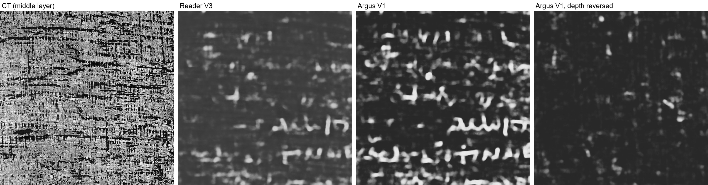

# Argus V1: ink detection for the Herculaneum scrolls

**Weights:** https://huggingface.co/ruiconte/argus-v1 (`argus-v1.pth`, MIT)

Argus V1 is a drop-in ink checkpoint for 9 µm-scale surface volumes. It uses the same network as `scrollprize/ink_9um` and
Reader V3 (`vesuvius_unet_3d_stem_2d`, 17-layer window, 34.6 M parameters) and the same file layout as `reader-v3.pth`, so
any tool that loads Reader V3 loads Argus V1 unchanged.

## Results

All numbers use 256 px tiles and 8-fold test-time augmentation. Every model is run through the same code.

**Never-seen scroll PHerc0841 w00** (team ink labels of 2026-09-18). No Argus training run ever saw this scroll.

| | **Argus V1** | Reader V3 | dense-native (Nieuwlaar) | dense-all7 (domenicor046) |
|---|---|---|---|---|
| AUC ↑ | **0.942** | 0.929 | 0.924 | 0.909 |
| balanced accuracy @0.5 ↑ | **0.850** | 0.843 | 0.842 | 0.812 |
| best Dice ↑ | 0.758 | **0.767** | 0.737 | 0.729 |
| background marked as ink at 80 % ink recall ↓ | 8.9 % | **8.5 %** | 10.9 % | 11.9 % |
| AUC with depth order reversed (should be ≈ 0.5) | 0.530 | 0.540 | 0.545 | 0.551 |

**Official validation masks** (PHerc0139 w016, PHerc0814 46527, PHerc1667 w029). These regions were held out of every Argus
training run.

| | **Argus V1** | Reader V3 | dense-native | dense-all7 |
|---|---|---|---|---|
| balanced accuracy @0.5 ↑ | **0.849** | 0.791 | 0.840 | 0.826 |
| AUC ↑ | **0.926** | 0.907 | 0.917 | 0.913 |
| best Dice ↑ | **0.764** | 0.707 | 0.743 | 0.739 |

Reader V3 was trained on native 113/116 keV scans. These masks use the 2.4 µm-derived volumes, so this table favours
models trained on that format. Read the PHerc0841 table first.

## Where Argus is weaker

- On PHerc0841, Reader V3 still has a slightly better Dice (0.767 vs 0.758) and marks slightly less background as ink
  (8.5 % vs 8.9 %).
- Argus marks more of the papyrus as ink than Reader V3. On PHerc0139 w053 at the same 80 % recall it flags 14.9 % of a
  central 3072 px crop, against 10.0 % for Reader V3.
- **That crop is not blank.** The team's 1 µm-scan map shows a line of letters inside it. When the depth order is
  reversed, Argus's marks in the crop fall from 14.9 % to 1.1 % (Reader V3's from 10.0 % to 2.7 %).
- **Pixels the team map calls blank.** Restricted to those pixels:
  - forward: Argus flags 10.3 % (Reader V3 6.9 %);
  - reversed: Argus flags 1.0 % (Reader V3 2.7 %).
- **Inner wrap w057.** On a central crop, Argus flags 8.9 % forward and 1.5 % reversed; Reader V3 flags 4.7 % and 2.2 %.
- **Ink the team map sees.** Argus finds 80 % of it on w053, Reader V3 61 %.
- **How to read this.** The extra marks depend on the physical depth direction. They look like faint ink, not like texture
  hallucination, but there are no human labels there to prove it. Treat them as leads to check, not as readings.


*PHerc0139 w053, central crop: CT, Reader V3, Argus V1, and Argus V1 with the layer order reversed.*


*Never-seen PHerc0841: Reader V3, Argus V1, Argus V1 reversed, human labels.*

## Use

- **HerculeX:**
  ```bash
  HERCULEX_WEIGHTS=/path/to/argus-v1.pth
  ```
- **Other tools:** anything that reads `reader-v3.pth` can read this file: it holds the same `model` keys and a `config`
  dict. Use a 17-layer window centred on the surface, robust MAD normalisation (1-99 %), and 256 px tiles or larger.
  Larger inference tiles helped every model we tested.

## How it was made

- **Base:** `domenicor046/ink9um-dense` `dense9um-all7-step075000.pth` (MIT).
- **Fine-tunes:** 8 runs of 8 000 iterations each.
  - Tiles: 256 px, batch 8.
  - Learning rate: 2.5e-4 or 5e-4, 4 seeds each.
  - Labels: dense pseudo-labels from `domenicor046/ink9um-dense`.
  - Loss: BCE with label smoothing 0.5, plus Dice.
  - Data: PHerc0139, PHerc1667, PHerc Paris 4 and PHerc0814 surface volumes from the Vesuvius Challenge open data.
- **Depth flip removed.** Unlike the reference recipe, the depth order is never flipped during training. With the flip, the
  model ignored the physical depth direction: reversed-order AUC was 0.79. Without it, reversed-order AUC is 0.53.
- **Weight soup.** The 8 fine-tunes share one initialisation and are averaged into one set of weights (Wortsman et al.,
  2022). The soup beats every single run on the validation masks.
- **Held out:** the validation masks above, all of PHerc0841, and PHerc0139 w053 were never used for training or model
  selection.

## Reproduce the numbers

```bash
pip install torch numpy zarr numcodecs scipy pillow requests safetensors
python prep.py                      # training / validation surface volumes (2.4 um, level 2, 21 pooled layers)
python dense_prep.py                # dense labels from domenicor046/ink9um-dense
python heldout_prep.py              # never-seen PHerc0841 w00 + PHerc0139 w053 in the same format
python eval_all.py                  # fetches the public checkpoints compared here
python heldout_eval.py --patch 256 --tta 8        # PHerc0841 table + w053 + reversed-order control
python val256.py argus-v1.pth official/reader-v3.pth   # validation-mask table
```

Training: `train.py --arch official --labels dense --iters 8000 --warmup 500 --patch 256 --batch 8
--init official/dense-all7-75k.pth --lr {2.5e-4|5e-4} --seed {1..4} --zflip 0`, then `soup.py --match <prefix>`.

## Credits

- Built on the `ink_9um` network and recipe (Vesuvius Challenge team).
- Uses the dense labels and checkpoints of domenicor046 (`ink9um-dense`; Reader V2/V3 for comparison).
- Compared against Nieuwlaar's `ink9um-dense-native`.
- All of these are MIT-licensed.
- Scan data: Vesuvius Challenge open data, under its own terms.

## Check

```bash
sha256sum argus-v1.pth
```

The result must match `SHA256SUMS` (`858b300d6e9d73d148a8790cda92d5bbd38fad15b3d6709c7c3f2dfd94fe4918`).

## License

MIT
