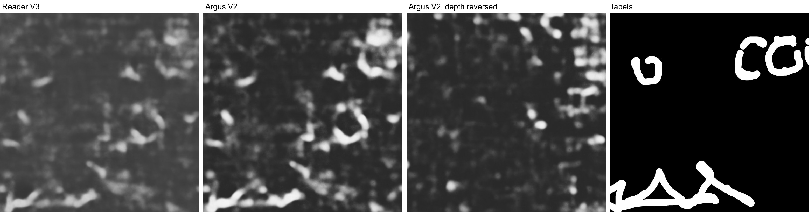
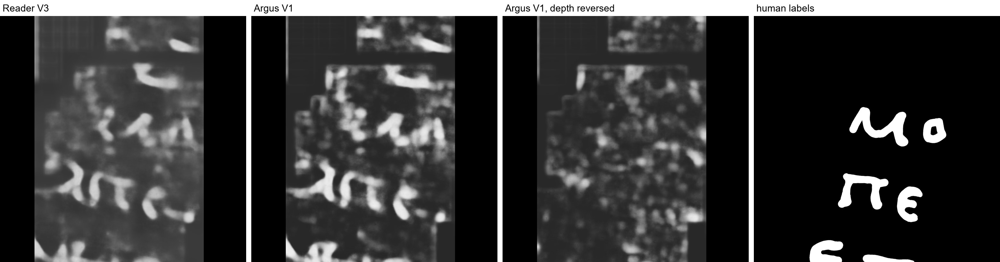

# Argus V3: ink detection on native 9 µm scans

**Weights:** https://huggingface.co/ruiconte/argus-v3 (`argus-v3.pth`, MIT). Argus V2 and V1 cards below.

Argus V3 beats Reader V3 on every metric of all five native test segments we have, none of which it was trained on. It
uses the same network and file layout as `reader-v3.pth`, so it is a drop-in replacement for HerculeX, ink-sdk or any
tool that loads Reader V3.

## Results

Both models are run through the same code, with 256 px tiles and 8-fold test-time augmentation. "Background marked as
ink" uses each model's own 80 % recall threshold.

**Native scans no model here was trained on**

| segment | AUC ↑ V3 / Reader V3 | bAcc@0.5 ↑ | Dice ↑ | background marked as ink ↓ |
|---|---|---|---|---|
| PHerc0841 w00, 113 keV | **0.924** / 0.913 | **0.835** / 0.764 | **0.728** / 0.718 | **11.5 %** / 13.2 % |
| PHerc0841 auto_grown …144552896, 113 keV | **0.837** / 0.820 | **0.753** / 0.724 | **0.666** / 0.650 | **31.0 %** / 33.8 % |
| PHerc0841 auto_grown …174252405, 113 keV | **0.855** / 0.852 | **0.795** / 0.734 | **0.666** / 0.645 | **20.8 %** / 23.5 % |
| PHerc1447 w058, 116 keV | **0.860** / 0.856 | **0.779** / 0.713 | **0.666** / 0.647 | **25.4 %** / 28.1 % |
| PHerc1447 w060, 116 keV | **0.791** / 0.776 | **0.680** / 0.613 | **0.558** / 0.493 | **39.8 %** / 42.1 % |

- PHerc0841 labels: the team labels from 2026-09-18, resampled onto the native render of the same mesh.
- PHerc1447 labels: the refined labels of YoussefMoNader.
- With the depth order reversed, AUC on PHerc0841 w00 is 0.512, so there is no invented ink.

Against Argus V2, V3 is better on 4 of the 5 segments, and fixes V2's weak spot (PHerc1447 w058: 0.854 → 0.860).

**Renders pooled from 2.4 µm scans**

| | metric | **Argus V3** | Reader V3 |
|---|---|---|---|
| PHerc0841 w00 (never seen) | AUC ↑ | **0.944** | 0.929 |
| | bAcc@0.5 ↑ | **0.868** | 0.843 |
| | background marked as ink ↓ | **7.6 %** | 8.5 % |
| official validation masks (3) | bAcc@0.5 ↑ | **0.793** | 0.791 |
| | AUC ↑ | 0.902 | **0.907** |
| | Dice ↑ | 0.694 | **0.707** |

## Where it is weaker

- **Validation masks.** On the official validation masks (pooled 2.4 µm renders of scrolls that are already read),
  Reader V3 keeps a slightly higher AUC and Dice. On that format, Argus V1 is still the best of all (bAcc 0.849).
- **Faint ink.** Gains on faint strokes are modest. As Discord testers noticed with V2, faint ink seems limited mainly
  by what the labels mark as ink.


*Native 113 keV render of PHerc0841, never seen: Reader V3, Argus V3, Argus V3 with the layer order reversed, team labels.*


*PHerc1447 w058, native 116 keV: the same four panels.*

## Use

- **HerculeX:**
  ```bash
  HERCULEX_WEIGHTS=/path/to/argus-v3.pth
  ```
- **Other tools:** load it exactly like `reader-v3.pth`.
- **Depth windows:** averaging windows shifted by −2, 0 and +2 layers adds about one more AUC point.

## How it was made

- **Weight average** (uniform) of 4 fine-tunes of `domenicor046/reader-v3` (MIT). All four share that initialisation.
- **Common settings:** 12 000 iterations, 256 px tiles, batch 8, SGD, BCE with label smoothing 0.5 plus Dice. The depth
  order is never flipped during training.
- **Data:** each run used a different random 30 % block-share of the 70 native segments in
  `domenicor046/reader-v2-labels` (MIT).
- **Learning rate:** 2.5e-4 for two runs, 5e-4 for the other two.
- **The fourth run** also trained on our 2.4 µm renders (PHerc0139, 1667, Paris 4, 0814). These were converted to look
  like native 113 keV scans with a scan-transfer kernel we fitted on the registered pooled/native pair of PHerc0814
  46527 (held-out R² 0.75). This run is what improved PHerc1447 w058.
- **Never used for training or selection:** PHerc0841 and PHerc1447.
- **Code:** https://github.com/ruiconte/ink-swarm (`native_v2_prep.py`, `fit_transfer.py`, `transfer_prep.py`,
  `train.py`, `seg_eval.py`).

## Credits

- Reader V3 and reader-v2-labels: domenicor046.
- The `ink_9um` network: the Vesuvius Challenge team.
- PHerc1447 test labels: YoussefMoNader (CC BY-NC 4.0, evaluation only).
- Independent check of V2 and integration into ink-sdk: pscamillo and LimeGS.
- Scan data: Vesuvius Challenge open data.

## Check

```bash
sha256sum argus-v3.pth
```

The result must be `2d887d2bffaadcefae1507bea269e04e1e79c47a6320cce6071d701b4089bbe3`.

## License

MIT


---

# Argus V2: ink detection on native 9 µm scans

**Weights:** https://huggingface.co/ruiconte/argus-v2 (`argus-v2.pth`, MIT). Argus V1 card below.

Argus V2 is Reader V3 fine-tuned on native 8–9 µm scans, the kind of scan the unread scrolls have. It uses the same
network and file layout as `reader-v3.pth`, so it is a drop-in replacement: HerculeX, ink-sdk or any tool that loads
Reader V3 loads Argus V2 unchanged.

V1 was trained on renders pooled from 2.4 µm scans. It was strong on that format, but on native 113 keV scans it lost to
Reader V3 (PHerc0841 AUC 0.869 vs 0.913), as pointed out on Discord. V2 fixes this.

## Results

All numbers use 256 px tiles and 8-fold test-time augmentation for both models, run through the same code. The
threshold for "background marked as ink" is each model's own 80 % recall threshold.

**Native scans no model here was trained on**

| | metric | **Argus V2** | Reader V3 |
|---|---|---|---|
| PHerc0841 w00, 9.37 µm / 113 keV | AUC ↑ | **0.924** | 0.913 |
| (team labels on the same mesh) | bAcc@0.5 ↑ | **0.828** | 0.764 |
| | Dice ↑ | **0.727** | 0.718 |
| | background marked as ink ↓ | **11.6 %** | 13.2 % |
| | AUC with depth order reversed (≈ 0.5 = no hallucination) | 0.509 | 0.532 |
| PHerc1447 w058, 8.64 µm / 116 keV | AUC ↑ | 0.854 | **0.856** |
| (refined labels, YoussefMoNader) | bAcc@0.5 ↑ | **0.767** | 0.713 |
| | Dice ↑ | **0.657** | 0.647 |
| | background marked as ink ↓ | **27.3 %** | 28.1 % |
| PHerc1447 w060, 8.64 µm / 116 keV | AUC ↑ | **0.787** | 0.776 |
| | bAcc@0.5 ↑ | **0.669** | 0.613 |
| | Dice ↑ | **0.547** | 0.493 |
| | background marked as ink ↓ | **41.5 %** | 42.1 % |

**Renders pooled from 2.4 µm scans (Argus V1's format)**

| | metric | **Argus V2** | Argus V1 | Reader V3 |
|---|---|---|---|---|
| PHerc0841 w00 (never seen) | AUC ↑ | **0.946** | 0.942 | 0.929 |
| | bAcc@0.5 ↑ | **0.872** | 0.850 | 0.843 |
| | Dice ↑ | **0.770** | 0.758 | 0.767 |
| | background marked as ink ↓ | **7.5 %** | 8.9 % | 8.5 % |
| PHerc0139 w053, central crop | marked as ink at the 0841 80 %-recall threshold | **6.4 %** | 14.9 % | 10.0 % |
| official validation masks (3) | bAcc@0.5 ↑ | 0.778 | **0.849** | 0.791 |
| | AUC ↑ | 0.898 | **0.926** | 0.907 |

The w053 crop is not fully blank: the team's 1 µm map shows a line of letters inside it. See the V1 card.

## Where Argus V2 is weaker

- On PHerc1447 w058 its AUC is 0.2 points below Reader V3, although Dice, bAcc and background are better there.
- On the three official validation masks (pooled renders), Argus V1 is still the better model, and Reader V3 is
  slightly ahead of V2. For pooled 2.4 µm renders of those scrolls, use V1. For native scans, use V2.


*Native 113 keV render of PHerc0841, which no model here was trained on: Reader V3, Argus V2, Argus V2 with the layer order reversed, team labels.*


*PHerc1447 w060, native 116 keV: the same four panels.*

## Use

- **HerculeX:**
  ```bash
  HERCULEX_WEIGHTS=/path/to/argus-v2.pth
  ```
- **Other tools:** load it exactly like `reader-v3.pth`, with a 17-layer window centred on the surface and robust MAD
  normalisation.
- **Depth windows:** averaging three windows shifted by −2, 0 and +2 layers adds about one AUC point to both models.
  On native 0841: Argus V2 0.928, Reader V3 0.922.

## How it was made

- **Start:** `domenicor046/reader-v3` (MIT).
- **Fine-tune:** 12 000 iterations on 256 px tiles, batch 8, SGD at learning rate 2.5e-4, BCE with label smoothing 0.5
  plus Dice. The depth order is never flipped during training.
- **Data:** a random 30 % share, in blocks, of the supervised area of the 70 native segments in
  `domenicor046/reader-v2-labels` (MIT), with the public native surface volumes. These cover PHerc0139, 0814 and 0500P2
  at 113 keV, PHerc0009B and 0343P at 116 keV, and PHerc0172 at 53 keV.
- **Checkpoint selection:** three held-out native segments from those labels (0139 w050, 0009B 20250511200236 and
  0814 20250925212701).
- **Never used for training or selection:** PHerc0841 and PHerc1447.
- **Code:** `native_v2_prep.py`, `train.py` and `seg_eval.py` in https://github.com/ruiconte/ink-swarm.

## Credits

- Reader V3 and reader-v2-labels: domenicor046.
- The `ink_9um` network: the Vesuvius Challenge team.
- PHerc1447 test labels: YoussefMoNader (CC BY-NC 4.0, used for evaluation only).
- Scan data: Vesuvius Challenge open data.

## Check

```bash
sha256sum argus-v2.pth
```

The result must be `659130f7fb6f67929f5dfd5a997d4e4bbbf49024bb818176bee846bca82de6fd`.

## License

MIT


---

# Argus V1: ink detection for the Herculaneum scrolls

**Weights:** https://huggingface.co/ruiconte/argus-v1 (`argus-v1.pth`, MIT)

Argus V1 is a drop-in ink checkpoint for 9 µm-scale surface volumes. It uses the same network as `scrollprize/ink_9um` and
Reader V3 (`vesuvius_unet_3d_stem_2d`, 17-layer window, 34.6 M parameters) and the same file layout as `reader-v3.pth`, so
any tool that loads Reader V3 loads Argus V1 unchanged.

## Results

All numbers use 256 px tiles and 8-fold test-time augmentation. Every model is run through the same code.

**Never-seen scroll PHerc0841 w00** (team ink labels of 2026-09-18). No Argus training run ever saw this scroll.

| | **Argus V1** | Reader V3 | dense-native (Nieuwlaar) | dense-all7 (domenicor046) |
|---|---|---|---|---|
| AUC ↑ | **0.942** | 0.929 | 0.924 | 0.909 |
| balanced accuracy @0.5 ↑ | **0.850** | 0.843 | 0.842 | 0.812 |
| best Dice ↑ | 0.758 | **0.767** | 0.737 | 0.729 |
| background marked as ink at 80 % ink recall ↓ | 8.9 % | **8.5 %** | 10.9 % | 11.9 % |
| AUC with depth order reversed (should be ≈ 0.5) | 0.530 | 0.540 | 0.545 | 0.551 |

**Official validation masks** (PHerc0139 w016, PHerc0814 46527, PHerc1667 w029). These regions were held out of every Argus
training run.

| | **Argus V1** | Reader V3 | dense-native | dense-all7 |
|---|---|---|---|---|
| balanced accuracy @0.5 ↑ | **0.849** | 0.791 | 0.840 | 0.826 |
| AUC ↑ | **0.926** | 0.907 | 0.917 | 0.913 |
| best Dice ↑ | **0.764** | 0.707 | 0.743 | 0.739 |

Reader V3 was trained on native 113/116 keV scans. These masks use the 2.4 µm-derived volumes, so this table favours
models trained on that format. Read the PHerc0841 table first.

## Where Argus is weaker

- On PHerc0841, Reader V3 still has a slightly better Dice (0.767 vs 0.758) and marks slightly less background as ink
  (8.5 % vs 8.9 %).
- Argus marks more of the papyrus as ink than Reader V3. On PHerc0139 w053 at the same 80 % recall it flags 14.9 % of a
  central 3072 px crop, against 10.0 % for Reader V3.
- **That crop is not blank.** The team's 1 µm-scan map shows a line of letters inside it. When the depth order is
  reversed, Argus's marks in the crop fall from 14.9 % to 1.1 % (Reader V3's from 10.0 % to 2.7 %).
- **Pixels the team map calls blank.** Restricted to those pixels:
  - forward: Argus flags 10.3 % (Reader V3 6.9 %);
  - reversed: Argus flags 1.0 % (Reader V3 2.7 %).
- **Inner wrap w057.** On a central crop, Argus flags 8.9 % forward and 1.5 % reversed; Reader V3 flags 4.7 % and 2.2 %.
- **Ink the team map sees.** Argus finds 80 % of it on w053, Reader V3 61 %.
- **How to read this.** The extra marks depend on the physical depth direction. They look like faint ink, not like texture
  hallucination, but there are no human labels there to prove it. Treat them as leads to check, not as readings.


*PHerc0139 w053, central crop: CT, Reader V3, Argus V1, and Argus V1 with the layer order reversed.*


*Never-seen PHerc0841: Reader V3, Argus V1, Argus V1 reversed, human labels.*

## Use

- **HerculeX:**
  ```bash
  HERCULEX_WEIGHTS=/path/to/argus-v1.pth
  ```
- **Other tools:** anything that reads `reader-v3.pth` can read this file: it holds the same `model` keys and a `config`
  dict. Use a 17-layer window centred on the surface, robust MAD normalisation (1-99 %), and 256 px tiles or larger.
  Larger inference tiles helped every model we tested.

## How it was made

- **Base:** `domenicor046/ink9um-dense` `dense9um-all7-step075000.pth` (MIT).
- **Fine-tunes:** 8 runs of 8 000 iterations each.
  - Tiles: 256 px, batch 8.
  - Learning rate: 2.5e-4 or 5e-4, 4 seeds each.
  - Labels: dense pseudo-labels from `domenicor046/ink9um-dense`.
  - Loss: BCE with label smoothing 0.5, plus Dice.
  - Data: PHerc0139, PHerc1667, PHerc Paris 4 and PHerc0814 surface volumes from the Vesuvius Challenge open data.
- **Depth flip removed.** Unlike the reference recipe, the depth order is never flipped during training. With the flip, the
  model ignored the physical depth direction: reversed-order AUC was 0.79. Without it, reversed-order AUC is 0.53.
- **Weight soup.** The 8 fine-tunes share one initialisation and are averaged into one set of weights (Wortsman et al.,
  2022). The soup beats every single run on the validation masks.
- **Held out:** the validation masks above, all of PHerc0841, and PHerc0139 w053 were never used for training or model
  selection.

## Reproduce the numbers

```bash
pip install torch numpy zarr numcodecs scipy pillow requests safetensors
python prep.py                      # training / validation surface volumes (2.4 um, level 2, 21 pooled layers)
python dense_prep.py                # dense labels from domenicor046/ink9um-dense
python heldout_prep.py              # never-seen PHerc0841 w00 + PHerc0139 w053 in the same format
python eval_all.py                  # fetches the public checkpoints compared here
python heldout_eval.py --patch 256 --tta 8        # PHerc0841 table + w053 + reversed-order control
python val256.py argus-v1.pth official/reader-v3.pth   # validation-mask table
```

Training: `train.py --arch official --labels dense --iters 8000 --warmup 500 --patch 256 --batch 8
--init official/dense-all7-75k.pth --lr {2.5e-4|5e-4} --seed {1..4} --zflip 0`, then `soup.py --match <prefix>`.

## Credits

- Built on the `ink_9um` network and recipe (Vesuvius Challenge team).
- Uses the dense labels and checkpoints of domenicor046 (`ink9um-dense`; Reader V2/V3 for comparison).
- Compared against Nieuwlaar's `ink9um-dense-native`.
- All of these are MIT-licensed.
- Scan data: Vesuvius Challenge open data, under its own terms.

## Check

```bash
sha256sum argus-v1.pth
```

The result must match `SHA256SUMS` (`858b300d6e9d73d148a8790cda92d5bbd38fad15b3d6709c7c3f2dfd94fe4918`).

## License

MIT

## Remus 0.1 (experimental): ink legitimacy across a stack of sheets

Idea and method by Louis De Puyfontaine: decide, for every ink spot of a sheet, whether it really belongs to that sheet or soaked in from a neighbouring wrap, by following motifs through the whole stack of sheets (trend = origin, chance-corrected, slip and anchors, ink moved back in proportion). Measured on public validated letters (PHerc. 0841 w00), including where it still fails. See [](remus/README.md).
