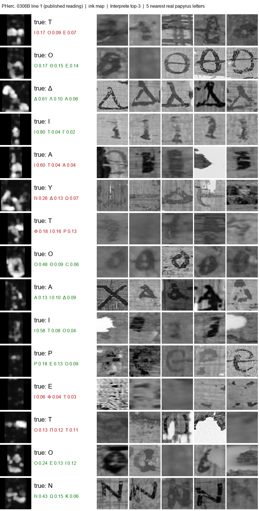
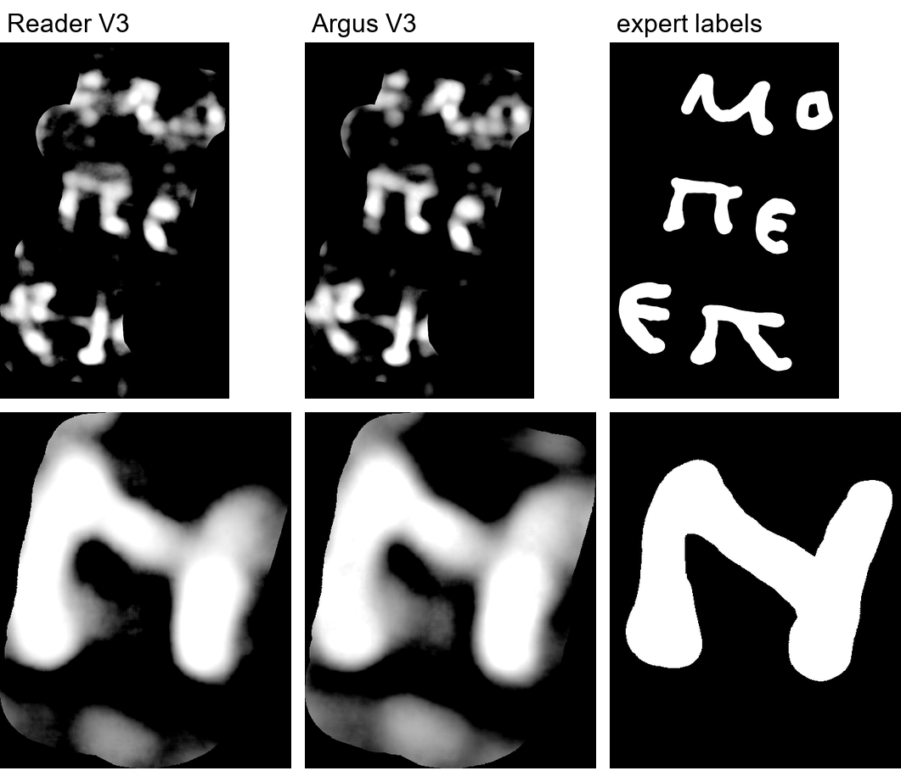

# Letter hunt: finding written areas in thousands of unwrapped pieces

A whole scroll unwrapped by [HerculeX](https://github.com/adambetka2/HerculeX) gives several thousand flattened pieces,
each with an ink map. Nobody can look at all of them. These tools sort the pieces so that a person looks at the few that
are most likely to hold writing, and they check every signal against a control so that fibres and noise are not taken
for letters.

The tools only rank where to look. Any reading of letters is for a papyrologist to make on the ink images themselves.

## Pipeline

1. **Ink maps over a whole scroll (Linux + CUDA).** `herculex/hx_full.sh` installs HerculeX upstream on a rented GPU
   machine, cuts the scroll into pieces and reads every piece with two independent ink models, one after the other:
   [Argus V3](https://huggingface.co/ruiconte/argus-v3) and Reader V3. Set `SCROLL` and `CORES`:
   `SCROLL=PHerc0826 CORES=48 bash hx_full.sh`.
2. **Rank by HerculeX's own control.** `side_rank.py` ranks pieces by HerculeX's per-piece side check: ink on the
   written face against ink with the depth layers scrambled. Writing gives a lot of ink on the written face and almost
   none once the layers are scrambled. This was the most useful ranking by far.
3. **Two models, same strokes.** Look at the top pieces with both ink models side by side (same plain grey display, a
   linear stretch from the 1st to the 99.5th percentile). Strokes drawn by two independently trained models in the same
   places are hard to explain by model artefacts.
4. **Letter shapes and lines (optional sorting).** `interprete.py` is a small Greek letter classifier (24 capitals +
   "not a letter"). `letter_scan.py` / `hx_letterscan.py` slide letter-sized windows over every map and over a control
   (transposed map or reversed depth layers). `rows_hunt.py` keeps places where at least 4 letter shapes sit on one line
   with regular spacing, and compares with the control.
5. **Depth re-read of a small surface.** `zone_depth.py` re-reads one surface at depth offsets −6…+6 with two models,
   forward and reversed, and keeps letter shapes that persist across depths and models. `propose.py` shows each
   persistent spot next to its 5 nearest real papyrus letters.

6. **Join neighbouring pieces.** `mosaic.py` pastes the ink maps of one HerculeX layout group at their positions from
   HerculeX's `layout.json` (unrolled-sheet millimetres, row/column flips), with no manual adjustment. Lines of writing
   that continue across piece borders are strong evidence against per-piece artefacts.
7. **Two-model consensus.** `consensus.py` rank-normalises two independent ink maps (removing any brightness/contrast
   difference), shows model B histogram-matched to model A, and keeps only what both models rank high (geometric mean).
   Isolated blobs from one model disappear; strokes seen by both stay.

## The letter classifier ("Interprète")

- Trained on real papyrus letters: HomerComp (`ext_letters.py`, CC BY-NC) and AL-PUB (`alpub_letters.py`).
- Damage added during training follows the physics of the scrolls: squashing and shearing, gaps along fibres, cracks
  with an offset, broken and blurred strokes.
- Check on already-published text, PHerc0306B line 1 (published reading by the Prodigle team, CC BY-NC 4.0):
  9 of 15 letters exact, 2 of 15 on a reversed-layer control. `letter_bench.py`, `publish_demo.py`.

Green = right, red = wrong. Shown per letter: the ink-map crop, the classifier's top 3, the 5 closest real papyrus letters.

## Fair comparison of ink models

`fair_compare.py` compares two ink models with both maps rank-normalised (identical histograms, so no brightness or
contrast difference is left) and scored only on held-out labelled regions. On PHerc0841 w00 and the three official
validation masks, Argus V3 and Reader V3 are tied on ranking (mean AUC 0.907 vs 0.907); Argus V3 is better calibrated
(usable at a 0.5 threshold with less background marked as ink). `fair_crop.py` makes the picture below.

## Notes

- Voxel size matters for the letter-size windows: pass the scan's µm (e.g. 9.362) to `hx_letterscan.py` / `rows_hunt.py`.
- On rented machines, set `OMP_NUM_THREADS`, `HERCULEX_BOARD_CORES`, `HERCULEX_SAMPLERS` and `HERCULEX_AHEAD` to the
  cores actually rented; the machine often shows many more threads than you pay for.
- License: MIT for this code. Data sets keep their own licenses.
