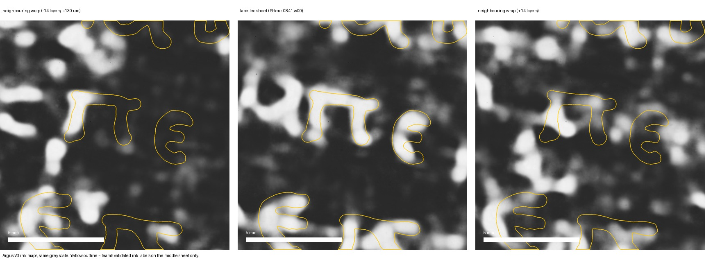

# Remus 0.1 (experimental): ink legitimacy across a stack of papyrus sheets

**Idea and method: Louis De Puyfontaine ([ruiconte](https://github.com/ruiconte)). Implementation: Louis De Puyfontaine with Claude (Anthropic).**
Status: **experimental**. Measured on public, papyrologist-validated letters; results below, including where it
fails. MIT licence, part of [ink-swarm](https://github.com/ruiconte/ink-swarm).

*Public data, PHerc. 0841 w00, Argus V3 ink maps on the same grey scale. Middle: the labelled sheet (yellow outline = team's validated ink labels). Left: the same place 14 layers (~130 um) deeper: the validated **Π** appears again, weaker. Right: 14 layers the other way. Whether this is offset onto the next wrap or the same sheet seen deeper is an open question.*

## The problem

In a rolled, carbonized Herculaneum scroll the wraps lie pressed against each other for two thousand years. An ink
detector reading one sheet in the CT sees ink that may not belong to that sheet: ink that soaked or was offset from a
neighbouring wrap, or a physical structure crossing the stack. Areas then look crowded with "letters" that are in
fact letters of several sheets on top of each other.

**Ink legitimacy** = the probability that an ink spot detected on sheet N really belongs to sheet N.

## The method (Louis De Puyfontaine's rules)

1. **Read the whole stack, not one sheet.** Render a "core" along the surface normals so that every neighbouring wrap
   is pixel-aligned (`render_tifxyz.py`, `multiwrap.py`: per-pixel tracking of each sheet), and read every sheet with
   the same ink model, in both layer orders (the reversed order is the control).
2. **Follow each motif through the stack.** For every ink spot, build its profile across sheets N-k..N+k.
   A repeat on L consecutive sheets happens by chance with probability ~p^L, where p is measured with the neighbour
   shifted by 6 mm (no real link possible).
3. **The trend points to the origin.** Ink is strongest where it was written and fades away from it: if the motif
   grows towards N+5, it belongs to N+5; if it fades from N, it belongs to N; flat over >= 3 sheets = a structure
   crossing the stack (crack, grain), belonging to no sheet.
4. **Move ink, do not delete it.** Ink that does not belong to N is removed from N *in proportion to the probability*,
   softly (to the local background level, feathered at the scale of the image blur), and **given back to the sheet it
   came from** (ink mass conserved).
5. **How much to move comes from intensity**, measured per pair of sheets in the windows where letter-scale shapes
   repeat beyond chance (`stack_unmix.py`, intensity mode, local echo maps).
6. **Sheets may have slipped.** Search shifts up to 1.5 mm per 3 mm window (`slip_search.py`); a real slip is
   *coherent* (neighbouring windows agree).
7. **Anchors.** Places where a motif repeats over several sheets fix the local alignment; a smooth displacement field
   is built between anchors, zones with contradictory or no anchors are folds/breaks and are excluded
   (`align_stack.py`).
8. **Grow the stack step by step** (32 -> 42 -> 52 sheets ...) and use the scroll's boundaries: the outermost and
   innermost wraps have a neighbour on one side only, so the unmixing can start there and peel towards the middle.

## Measured on validated letters (PHerc. 0841, segment w00, public labels)

`calibrate_on_labels.py`, core of 3 real sheets (-14 / 0 / +14 layers), Argus V3 ink model:

| | sheet -14 | sheet +14 |
|---|---|---|
| true letters also ink on the neighbour | 38.8 % (chance 25.5 %) | 32.6 % (chance 17.0 %) |
| false ink (model ink outside the letters) also on the neighbour | 39.2 % (chance 26.3 %) | 30.7 % (chance 13.4 %) |
| co-located neighbour ink intensity on true letters | 0.97 of the page | 0.92 of the page |

- Real letters **do** echo onto neighbouring wraps, well above chance.
- But false ink echoes just as much, so "shared with a neighbour" alone does not single out foreign ink.
- The pairwise program (`legitimacy_pair.py`) removes on average **10.5 % of false ink and 6.3 % of true letters**:
  better than chance (1.7x), **not yet good enough** (our own gate is < 5 % of true letters removed).
- Tried and rejected: "the sharper sheet is the original" (removes 16 % of true letters).

Full numbers: `calibration_PHerc0841_w00.json`.

## Files

| file | role |
|---|---|
| `src/render_tifxyz.py` | render CT layers along a tifxyz mesh (deep render = core) |
| `src/multiwrap.py` | find every sheet in the core and follow it pixel by pixel; reads with the ink model (needs `train.py`, `eval_all.py` from ink-swarm) |
| `src/legitimacy_pair.py` | page sheet vs its neighbours: chance-corrected evidence, trend, proportional move |
| `src/stack_unmix.py` | whole stack at once, both directions, local intensity echoes, ink given back |
| `src/slip_search.py` | slip between sheets, coherence test |
| `src/align_stack.py` | anchors -> displacement field -> reliable mask, iterative |
| `src/calibrate_on_labels.py` | measure everything above on validated letters |

## Résumé en français (Remus 0.1, version expérimentale)

L'encre que voit un détecteur sur une feuille d'un rouleau carbonisé ne lui appartient pas toujours : elle peut venir
d'une feuille voisine (décalque) ou d'une structure qui traverse la pile. La méthode de Louis De Puyfontaine analyse toute la pile de
feuilles, suit chaque motif à travers les feuilles, déduit la feuille d'origine du sens de la décroissance, tient
compte du hasard, du glissement entre feuilles et des zones de pliure, et déplace l'encre en proportion de la
probabilité au lieu de l'effacer. Mesurée sur des lettres validées par des papyrologues : les vraies lettres
déteignent bien sur leurs voisines, et le programme retire 1,7 fois plus de fausse encre que de vraies lettres, ce qui
est encore insuffisant. Méthode expérimentale, publiée avec ses chiffres.
