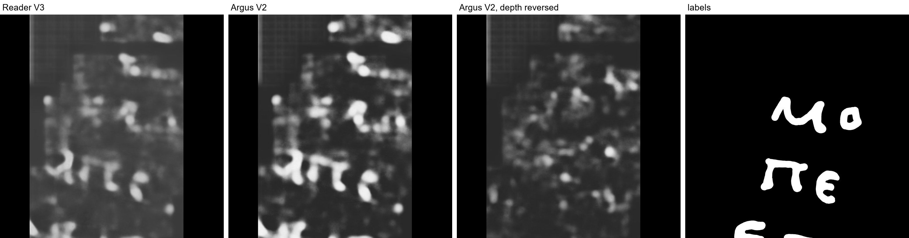
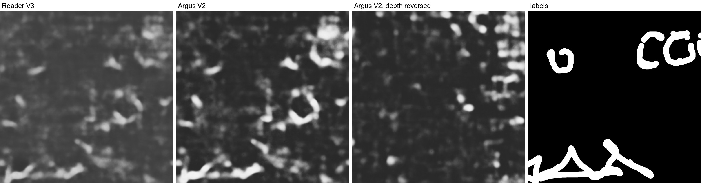

# Argus V2: ink detection on native 9 µm scans

Argus V2 is Reader V3 fine-tuned on native 8–9 µm scans, the kind of scan the unread scrolls have. It uses the same
network and file layout as `reader-v3.pth`, so it is a drop-in replacement: HerculeX, ink-sdk or any tool that loads
Reader V3 loads Argus V2 unchanged.

V1 was trained on renders pooled from 2.4 µm scans. It was strong on that format, but on native 113 keV scans it lost to
Reader V3 (PHerc0841 AUC 0.869 vs 0.913), as pointed out on Discord. V2 fixes this.

## Results

All numbers use 256 px tiles and 8-fold test-time augmentation for both models, run through the same code. The
threshold for "background marked as ink" is each model's own 80 % recall threshold.

**Native scans no model here was trained on**

| | metric | **Argus V2** | Reader V3 |
|---|---|---|---|
| PHerc0841 w00, 9.37 µm / 113 keV | AUC ↑ | **0.924** | 0.913 |
| (team labels on the same mesh) | bAcc@0.5 ↑ | **0.828** | 0.764 |
| | Dice ↑ | **0.727** | 0.718 |
| | background marked as ink ↓ | **11.6 %** | 13.2 % |
| | AUC with depth order reversed (≈ 0.5 = no hallucination) | 0.509 | 0.532 |
| PHerc1447 w058, 8.64 µm / 116 keV | AUC ↑ | 0.854 | **0.856** |
| (refined labels, YoussefMoNader) | bAcc@0.5 ↑ | **0.767** | 0.713 |
| | Dice ↑ | **0.657** | 0.647 |
| | background marked as ink ↓ | **27.3 %** | 28.1 % |
| PHerc1447 w060, 8.64 µm / 116 keV | AUC ↑ | **0.787** | 0.776 |
| | bAcc@0.5 ↑ | **0.669** | 0.613 |
| | Dice ↑ | **0.547** | 0.493 |
| | background marked as ink ↓ | **41.5 %** | 42.1 % |

**Renders pooled from 2.4 µm scans (Argus V1's format)**

| | metric | **Argus V2** | Argus V1 | Reader V3 |
|---|---|---|---|---|
| PHerc0841 w00 (never seen) | AUC ↑ | **0.946** | 0.942 | 0.929 |
| | bAcc@0.5 ↑ | **0.872** | 0.850 | 0.843 |
| | Dice ↑ | **0.770** | 0.758 | 0.767 |
| | background marked as ink ↓ | **7.5 %** | 8.9 % | 8.5 % |
| PHerc0139 w053, central crop | marked as ink at the 0841 80 %-recall threshold | **6.4 %** | 14.9 % | 10.0 % |
| official validation masks (3) | bAcc@0.5 ↑ | 0.778 | **0.849** | 0.791 |
| | AUC ↑ | 0.898 | **0.926** | 0.907 |

The w053 crop is not fully blank: the team's 1 µm map shows a line of letters inside it. See the V1 card.

## Where Argus V2 is weaker

- On PHerc1447 w058 its AUC is 0.2 points below Reader V3, although Dice, bAcc and background are better there.
- On the three official validation masks (pooled renders), Argus V1 is still the better model, and Reader V3 is
  slightly ahead of V2. For pooled 2.4 µm renders of those scrolls, use V1. For native scans, use V2.


*Native 113 keV render of PHerc0841, which no model here was trained on: Reader V3, Argus V2, Argus V2 with the layer order reversed, team labels.*


*PHerc1447 w060, native 116 keV: the same four panels.*

## Use

- **HerculeX:**
  ```bash
  HERCULEX_WEIGHTS=/path/to/argus-v2.pth
  ```
- **Other tools:** load it exactly like `reader-v3.pth`, with a 17-layer window centred on the surface and robust MAD
  normalisation.
- **Depth windows:** averaging three windows shifted by −2, 0 and +2 layers adds about one AUC point to both models.
  On native 0841: Argus V2 0.928, Reader V3 0.922.

## How it was made

- **Start:** `domenicor046/reader-v3` (MIT).
- **Fine-tune:** 12 000 iterations on 256 px tiles, batch 8, SGD at learning rate 2.5e-4, BCE with label smoothing 0.5
  plus Dice. The depth order is never flipped during training.
- **Data:** a random 30 % share, in blocks, of the supervised area of the 70 native segments in
  `domenicor046/reader-v2-labels` (MIT), with the public native surface volumes. These cover PHerc0139, 0814 and 0500P2
  at 113 keV, PHerc0009B and 0343P at 116 keV, and PHerc0172 at 53 keV.
- **Checkpoint selection:** three held-out native segments from those labels (0139 w050, 0009B 20250511200236 and
  0814 20250925212701).
- **Never used for training or selection:** PHerc0841 and PHerc1447.
- **Code:** `native_v2_prep.py`, `train.py` and `seg_eval.py` in https://github.com/ruiconte/ink-swarm.

## Credits

- Reader V3 and reader-v2-labels: domenicor046.
- The `ink_9um` network: the Vesuvius Challenge team.
- PHerc1447 test labels: YoussefMoNader (CC BY-NC 4.0, used for evaluation only).
- Scan data: Vesuvius Challenge open data.

## Check

```bash
sha256sum argus-v2.pth
```

The result must be `659130f7fb6f67929f5dfd5a997d4e4bbbf49024bb818176bee846bca82de6fd`.

## License

MIT
