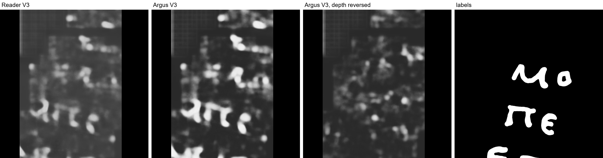
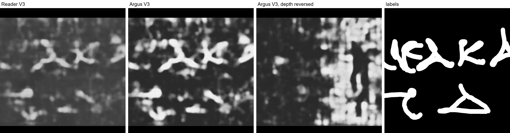

# Argus V3: ink detection on native 9 µm scans

Argus V3 beats Reader V3 on every metric of all five native test segments we have, none of which it was trained on. It
uses the same network and file layout as `reader-v3.pth`, so it is a drop-in replacement for HerculeX, ink-sdk or any
tool that loads Reader V3.

## Results

Both models are run through the same code, with 256 px tiles and 8-fold test-time augmentation. "Background marked as
ink" uses each model's own 80 % recall threshold.

**Native scans no model here was trained on**

| segment | AUC ↑ V3 / Reader V3 | bAcc@0.5 ↑ | Dice ↑ | background marked as ink ↓ |
|---|---|---|---|---|
| PHerc0841 w00, 113 keV | **0.924** / 0.913 | **0.835** / 0.764 | **0.728** / 0.718 | **11.5 %** / 13.2 % |
| PHerc0841 auto_grown …144552896, 113 keV | **0.837** / 0.820 | **0.753** / 0.724 | **0.666** / 0.650 | **31.0 %** / 33.8 % |
| PHerc0841 auto_grown …174252405, 113 keV | **0.855** / 0.852 | **0.795** / 0.734 | **0.666** / 0.645 | **20.8 %** / 23.5 % |
| PHerc1447 w058, 116 keV | **0.860** / 0.856 | **0.779** / 0.713 | **0.666** / 0.647 | **25.4 %** / 28.1 % |
| PHerc1447 w060, 116 keV | **0.791** / 0.776 | **0.680** / 0.613 | **0.558** / 0.493 | **39.8 %** / 42.1 % |

- PHerc0841 labels: the team labels from 2026-09-18, resampled onto the native render of the same mesh.
- PHerc1447 labels: the refined labels of YoussefMoNader.
- With the depth order reversed, AUC on PHerc0841 w00 is 0.512, so there is no invented ink.

Against Argus V2, V3 is better on 4 of the 5 segments, and fixes V2's weak spot (PHerc1447 w058: 0.854 → 0.860).

**Renders pooled from 2.4 µm scans**

| | metric | **Argus V3** | Reader V3 |
|---|---|---|---|
| PHerc0841 w00 (never seen) | AUC ↑ | **0.944** | 0.929 |
| | bAcc@0.5 ↑ | **0.868** | 0.843 |
| | background marked as ink ↓ | **7.6 %** | 8.5 % |
| official validation masks (3) | bAcc@0.5 ↑ | **0.793** | 0.791 |
| | AUC ↑ | 0.902 | **0.907** |
| | Dice ↑ | 0.694 | **0.707** |

## Where it is weaker

- **Validation masks.** On the official validation masks (pooled 2.4 µm renders of scrolls that are already read),
  Reader V3 keeps a slightly higher AUC and Dice. On that format, Argus V1 is still the best of all (bAcc 0.849).
- **Faint ink.** Gains on faint strokes are modest. As Discord testers noticed with V2, faint ink seems limited mainly
  by what the labels mark as ink.


*Native 113 keV render of PHerc0841, never seen: Reader V3, Argus V3, Argus V3 with the layer order reversed, team labels.*


*PHerc1447 w058, native 116 keV: the same four panels.*

## Use

- **HerculeX:**
  ```bash
  HERCULEX_WEIGHTS=/path/to/argus-v3.pth
  ```
- **Other tools:** load it exactly like `reader-v3.pth`.
- **Depth windows:** averaging windows shifted by −2, 0 and +2 layers adds about one more AUC point.

## How it was made

- **Weight average** (uniform) of 4 fine-tunes of `domenicor046/reader-v3` (MIT). All four share that initialisation.
- **Common settings:** 12 000 iterations, 256 px tiles, batch 8, SGD, BCE with label smoothing 0.5 plus Dice. The depth
  order is never flipped during training.
- **Data:** each run used a different random 30 % block-share of the 70 native segments in
  `domenicor046/reader-v2-labels` (MIT).
- **Learning rate:** 2.5e-4 for two runs, 5e-4 for the other two.
- **The fourth run** also trained on our 2.4 µm renders (PHerc0139, 1667, Paris 4, 0814). These were converted to look
  like native 113 keV scans with a scan-transfer kernel we fitted on the registered pooled/native pair of PHerc0814
  46527 (held-out R² 0.75). This run is what improved PHerc1447 w058.
- **Never used for training or selection:** PHerc0841 and PHerc1447.
- **Code:** https://github.com/ruiconte/ink-swarm (`native_v2_prep.py`, `fit_transfer.py`, `transfer_prep.py`,
  `train.py`, `seg_eval.py`).

## Credits

- Reader V3 and reader-v2-labels: domenicor046.
- The `ink_9um` network: the Vesuvius Challenge team.
- PHerc1447 test labels: YoussefMoNader (CC BY-NC 4.0, evaluation only).
- Independent check of V2 and integration into ink-sdk: pscamillo and LimeGS.
- Scan data: Vesuvius Challenge open data.

## Check

```bash
sha256sum argus-v3.pth
```

The result must be `2d887d2bffaadcefae1507bea269e04e1e79c47a6320cce6071d701b4089bbe3`.

## License

MIT
